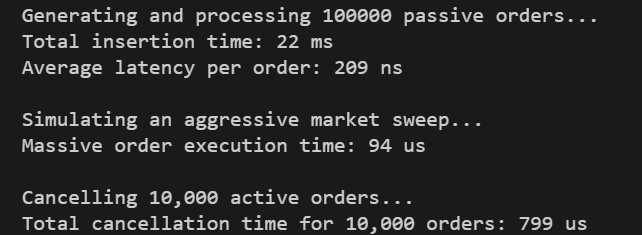

# Limit Order Book

A C++17 price-time-priority limit order book with multi-level matching, partial fills, and iterator-backed cancellation.

## Build

```powershell
cmake -S . -B build
cmake --build build --config Release
ctest --test-dir build -C Release --output-on-failure
```

The reusable implementation is built as the `order_book` library. `matching_engine` runs the local benchmark in `src/main.cpp`, while `order_book_tests` validates matching behavior through CTest.

## Design

- Bid price levels use descending order; ask price levels use ascending order.
- Each price level stores orders in a `std::list`, preserving FIFO priority.
- `orderMap` maps an active order ID to its side, price level, and list iterator.
- Matching is price-time priority. A match emits maker ID, taker ID, execution price, and quantity.
- Cancellation is average-case O(1) for the hash lookup and list erase, followed by removal of an empty price level.
- Adding an order visits crossed price levels and is O(log P + K), where `P` is the number of price levels and `K` is the number of orders consumed.

Duplicate IDs and zero-quantity orders are rejected before matching.

## Benchmark

The benchmark currently processes 100,000 passive orders, runs one aggressive sweep, and cancels 10,000 active orders. On a local Windows Release build, one observed run reported:

